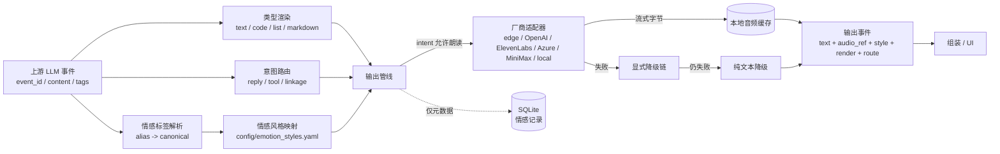

# MoodVoice · 情感语音输出层

一个可独立运行的 **标签驱动情感 TTS 输出层**。它接收上游 LLM 已打标的结果，把
`emotion / type / intent` 分别消费为 **语音风格、文本渲染方式、下游路由**，输出
`text + audio_ref + style` 事件；任一 TTS 厂商失败时保留完整文本并优雅降级。

> 不做情感分类。分类是上游的职责；本层只消费标签，并把“这个标签应该怎么被听见”
> 变成可审计的厂商参数。

---

## 30 秒跑起来（无需任何密钥）

```powershell
python -m venv .venv
.\.venv\Scripts\Activate.ps1
pip install -r requirements.txt
pip install -e .
Copy-Item .env.example .env
python -m emotional_tts serve
```

打开 **http://127.0.0.1:8765**，输入一段文字，点击“生成情感语音”。

默认使用 `edge-tts`：免账号、免密钥，适合开箱即用 Demo。它会把朗读文本发往微软
在线朗读服务；如果要求文本完全不出本机，请配置 `local` 适配器（见
[厂商接入](docs/PROVIDERS.md)）。

也可以完全不启动 Web：

```powershell
python -m emotional_tts demo "今天辛苦了，先慢慢呼吸一下。" --emotion comfort --provider edge --out .data/demo.mp3
```

---

## 它解决什么

| 上游标签 | 本层消费结果 | 可观察输出 |
|---|---|---|
| `tags.emotion = comfort` | 从 12 类情感映射表选出语速、音高、音色和厂商风格 | `style.emotion=comfort, speed=0.92, tone=温柔低缓` |
| `tags.type = code` | 原文本照常渲染；另生成不含代码符号的 `speech_text` | 屏幕上显示代码块，朗读“代码已经显示在屏幕上” |
| `tags.type = list` | 去除列表符号，保留条目顺序 | UI 列表 + 连贯朗读 |
| `tags.intent = tool` | 只下发文本，不合成语音 | `route.destination=ui.tool_result` |
| `tags.intent = linkage` | 路由到下游集成层，不朗读 | `route.destination=integration.linkage` |
| 厂商超时/401/限流 | 按显式降级链尝试，最终返回纯文本 | `status=text_fallback, degraded=true` |

## 功能一览

- **6 个内置适配器**：`edge`、OpenAI TTS、ElevenLabs、Azure Neural TTS、MiniMax 海螺、本地 HTTP。
- **统一流式接口**：厂商字节流边到边写入本地缓存；WebSocket 边合成边播放（MSE），首响优先。
- **可配置情感映射**：`config/emotion_styles.yaml` 定义 12 类情感及中英文别名、语速/音高/音量、厂商覆盖参数。
- **意图路由**：`config/routes.yaml` 配置 `reply / tool / linkage` 的下游目的地与是否朗读。
- **可插拔厂商**：实现 `TTSProvider` 的 `stream()` 即可接入；能力声明区分原生情感风格、指令、韵律和风格强度。
- **纯文本降级**：失败不会产生半截音频；流中断会删除不完整文件并记录结构化结果。
- **隐私优先**：BYOK、密钥只在服务端环境变量、日志脱敏、同源校验、仅监听本机、音频缓存可清除。
- **结构化记录**：SQLite 保存情感标签、解析结果、厂商参数、延迟与降级原因，**不保存原文**，供后续版本复用。

## 架构



## 对外契约

输入（沿用题面契约）：

```json
{
  "event_id": "3f5b0c1e-6e25-4f5b-9d4e-0b6f9f6c1a21",
  "session_id": "ece2a4d8-3c5f-4e98-8d81-a01d2f2c6b77",
  "content": "今天辛苦了，先慢慢呼吸一下。",
  "stream": true,
  "tags": {"emotion": "comfort", "type": "text", "intent": "reply"}
}
```

输出（四个必需字段保持不变，其余为可安全忽略的增量字段）：

```json
{
  "event_id": "3f5b0c1e-6e25-4f5b-9d4e-0b6f9f6c1a21",
  "text": "今天辛苦了，先慢慢呼吸一下。",
  "audio_ref": "/api/v1/audio/8d5e....mp3",
  "style": {
    "emotion": "comfort",
    "label": "安慰",
    "speed": 0.92,
    "tone": "温柔低缓，有陪伴感",
    "source_tag": "comfort",
    "mapping_hit": true
  },
  "speech_text": "今天辛苦了，先慢慢呼吸一下。",
  "render": {"type": "text", "mode": "plain", "blocks": []},
  "route": {
    "intent": "reply",
    "destination": "ui.voice_reply",
    "synthesize": true,
    "reason": "spoken assistant reply"
  },
  "provider": "edge",
  "status": "synthesized",
  "degraded": false,
  "diagnostics": {
    "emotion_mapping": {"mapping_hit": true, "fallback_reason": null},
    "provider_attempts": [{"provider": "edge", "outcome": "succeeded"}],
    "privacy": {"content_logged": false, "text_sent_to": [{"provider": "edge"}]}
  },
  "timings": {"first_chunk_ms": 808.8, "total_ms": 1050.1}
}
```

- `text` 永远是上游原文，不改写。
- `speech_text` 是实际朗读稿，代码/列表/Markdown 会做朗读安全清理。
- `audio_ref` 是同源相对 URL；音频只落在本地 `.data/cache/`。
- 失败时 `audio_ref=null`、`status=text_fallback`、`degraded=true`，并在
  `degradation`/`diagnostics` 中说明原因。

## 情感映射（摘录）

完整配置见 [`config/emotion_styles.yaml`](config/emotion_styles.yaml)。

| 标签 | 语气 | speed | Azure 原生风格 | OpenAI 指令 | ElevenLabs style |
|---|---|---:|---|---|---:|
| `comfort` | 温柔低缓，有陪伴感 | 0.92 | `gentle` / 1.6 | caring friend, slow | 0.45 |
| `joy` | 明亮轻快，带一点笑意 | 1.08 | `cheerful` / 1.5 | bright, warm smile | 0.65 |
| `excitement` | 高昂有能量，节奏明快 | 1.14 | `cheerful` / 1.8 | genuine excitement | 0.80 |
| `calm` | 平稳舒缓，呼吸感 | 0.90 | `calm` / 1.4 | slow and grounded | 0.35 |
| `sadness` | 低沉克制，带一点叹息 | 0.88 | `sad` / 1.5 | restrained sadness | 0.50 |
| `apology` | 诚恳放低，认真负责 | 0.93 | `serious` / 1.3 | sincere, accountable | 0.40 |

未知标签不会被静默吞掉：会回退到 `neutral`，同时把 `mapping_hit=false` 和
`fallback_reason=unknown_tag` 写入输出和记录。

## 厂商

| ID | 情感表达能力 | 流式 | 密钥 | 说明 |
|---|---|---|---|---|
| `edge` | 韵律（音色/语速/音高/音量） | ✅ | 不需要 | 免账号 Demo；在线服务 |
| `azure` | **原生 `mstts:express-as` 风格** + 强度 | ✅ | 需要 | 情感表达最直接 |
| `openai` | `instructions` 自然语言表演指令 | ✅ | 需要 | `gpt-4o-mini-tts` |
| `elevenlabs` | `stability / style / speed` 风格强度 | ✅ | 需要 | 需要 Voice ID |
| `minimax` | `voice_setting.emotion` 枚举 | ❌ 同步 | 需要 | 首响高于流式厂商 |
| `local` | 自定义 `style` 载荷 | ✅ | 可选 | GPT-SoVITS/CosyVoice/F5-TTS 封装 |

也评估并推荐了 Cartesia、火山引擎/豆包、阿里云、讯飞、腾讯云、Deepgram 等；其中
部分需要各自签名协议或私有 SDK，未内置的原因与接入方式见
[`docs/PROVIDERS.md`](docs/PROVIDERS.md)。本仓库只做接入，不提供任何密钥或账户。

## BYOK 快速指路

复制 `.env.example` 为 `.env`，只填写你实际使用的厂商：

```dotenv
# OpenAI
OPENAI_API_KEY=
# ElevenLabs（Voice ID 不是密钥，放 config/app.yaml）
ELEVENLABS_API_KEY=
# Azure
AZURE_SPEECH_KEY=
AZURE_SPEECH_REGION=eastasia
# MiniMax
MINIMAX_API_KEY=
MINIMAX_GROUP_ID=
# 本地服务
LOCAL_TTS_URL=http://127.0.0.1:9880/synthesize
```

然后执行 `moodvoice providers` 查看就绪状态，重启服务，在 Demo 里切换厂商。
完整步骤（含各厂商控制台入口）见 [用户文档](docs/USER_GUIDE.md)。

## 测试

```powershell
# 单元 / 契约 / 适配器 / 隐私测试（不访问外网）
python -m pytest -q

# 实际调用 edge-tts 的 live smoke test（默认跳过）
$env:MOODVOICE_LIVE_TESTS="1"
python -m pytest -q -m live -s
```

最近一次结果（2026-10-24，Windows / Python 3.12.14）：

- `60 passed, 1 skipped`（跳过 live）
- live 测试：`1 passed`，真实 edge-tts 首响稳定样本 0.77–0.86 s（网络抖动时可达数秒，仍在超时阈值内）
- 浏览器端：流式 MSE 播放、代码渲染、意图路由、纯文本降级、移动端均通过，无外部请求
- 多厂商切换、显式降级、纯文本降级、流中断清理、日志脱敏、缓存路径穿越、
  API/WS 契约均有测试覆盖

详细矩阵、根因定位方法与已知限制见
[`docs/TEST_REPORT.md`](docs/TEST_REPORT.md) 和
[`docs/ROOT_CAUSE_PLAYBOOK.md`](docs/ROOT_CAUSE_PLAYBOOK.md)。

## 隐私与安全（摘要）

- 文本只发往**你选择的 TTS 厂商**或本地服务；没有配置的厂商不会被调用。
- 厂商降级链必须显式配置；默认失败直接纯文本，不偷偷外发。
- API 密钥只从本地 `.env` / 环境变量读取，不进浏览器、不进日志、不进 API 响应。
- 音频缓存位于 `.data/cache/`，UI/API/CLI 均可清除；结构化记录不保存原文。
- 默认只监听 `127.0.0.1`；非浏览器请求与跨站 Origin 会被拒绝。
- 仓库不包含 `.env`、模型权重、用户音频或测试音频。

完整数据流见 [`docs/PRIVACY.md`](docs/PRIVACY.md)。

## 仓库结构

```text
config/                 # 主配置、情感映射、意图路由
src/emotional_tts/
  api.py                # REST + WebSocket + 同源/CSP 防护
  pipeline.py           # 标签消费 -> 合成 -> 降级 -> 记录
  styles.py             # 情感别名与厂商参数解析
  rendering.py          # type -> 渲染块 + 朗读稿
  routing.py            # intent -> 下游路由
  providers/            # 可插拔厂商适配器
  storage.py            # 只存结构化情感/风格元数据
  cache.py              # 本地音频缓存与清理
  web/                  # 无构建步骤的 Demo UI
tests/                  # 单元、契约、适配器、API、隐私测试
docs/                   # 用户/开发/隐私/厂商/根因/测试报告
```

## 文档

- [用户文档（BYOK 与 Demo）](docs/USER_GUIDE.md)
- [开发文档（标签消费、风格映射、扩展厂商）](docs/DEVELOPER_GUIDE.md)
- [厂商接入说明](docs/PROVIDERS.md)
- [隐私与安全](docs/PRIVACY.md)
- [情感风格根因排查手册](docs/ROOT_CAUSE_PLAYBOOK.md)
- [测试报告](docs/TEST_REPORT.md)

## 已知边界

- 这是一个**本机 Demo / 单机输出层**，没有多租户鉴权。不要直接暴露到公网；如需局域网访问，
  必须自行加反向代理鉴权，并配置 `EMOTION_TTS_ALLOWED_ORIGINS`。
- 商业厂商适配器通过 mock HTTP 做契约测试；真实账户的密钥、计费和音色授权由用户负责。
- MSE 对流式 MP3 的支持取决于浏览器；不支持时会自动退化为整段 Blob 播放，服务端首响指标仍有效。
- 超长文本按 `max_tts_chars` 截断并明确标注；版本化分段合成可作为下一版扩展。

## License

MIT。见 [LICENSE](LICENSE)。
