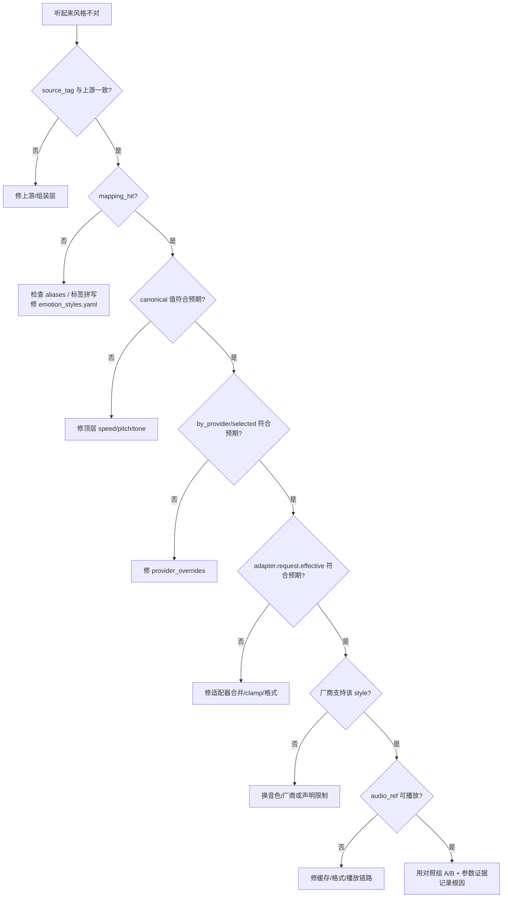

# 情感风格根因排查手册

> 原则：**先证明是哪一层错了，再改那一层。**
> 不允许用“把语速调慢一点/音调降一点”掩盖标签映射、厂商参数或适配层的错误。

情感风格不对应，至少可能来自五层：

```text
上游标签 → 别名映射 → 厂商参数合并 → 适配器请求 → 厂商能力/音色 → 播放
            ①            ②               ③            ④            ⑤
```

本手册给出证据链、决策树、真实案例与错误码表。

---

## 1. 先固定变量

排查时使用**同一段文本、同一个语音厂商、同一个音色**，只改一个标签：

```powershell
moodvoice demo "今天辛苦了，先慢慢呼吸一下。" --emotion comfort --provider azure --out .data/diag-comfort.mp3
moodvoice demo "今天辛苦了，先慢慢呼吸一下。" --emotion joy --provider azure --out .data/diag-joy.mp3
```

将两段音频做 A/B，而不是凭记忆比较。检查：

- 输出 JSON 的 `style`、`route`、`provider`；
- `diagnostics.emotion_mapping`；
- `diagnostics.provider_params`；
- `diagnostics.adapter.request.effective`；
- `diagnostics.provider_attempts`；
- 音频是否完整、能否用播放器直接打开。

---

## 2. 五步定位

### 第 1 步：上游标签是不是你以为的那个？

看：

```json
"diagnostics": {
  "emotion_mapping": {
    "source_tag": "comfort",
    "resolved_emotion": "comfort",
    "mapping_hit": true,
    "fallback_reason": null
  }
}
```

- `source_tag` 与上游事件不一致 → 上游/组装层问题，不是 TTS；
- `mapping_hit=false` → 标签映射层；
- `fallback_reason=missing_tag` → 上游没给标签；
- `fallback_reason=unknown_tag` → `aliases` 缺失或拼写不一致。

不要在这一步改 TTS 参数。

### 第 2 步：映射后的 canonical 值是否符合预期？

看：

```json
"provider_params": {
  "canonical": {"emotion": "comfort", "speed": 0.92, "pitch_semitones": -1, "tone": "温柔低缓"},
  "by_provider": {
    "azure": {"style": "gentle", "style_degree": 1.6, "pitch": "-2%"}
  },
  "selected": {"style": "gentle", "style_degree": 1.6}
}
```

- `canonical` 不对 → `config/emotion_styles.yaml` 的顶层值问题；
- `by_provider` 不对 → 该厂商的 `provider_overrides` 问题；
- `selected` 不对 → 厂商选择或 `provider_params` 合并问题；
- 修复位置：配置/`styles.py`，不是适配器。

### 第 3 步：适配器实际准备发什么？

看：

```json
"diagnostics": {
  "adapter": {
    "name": "azure",
    "request": {
      "effective": {
        "voice": "zh-CN-XiaoxiaoNeural",
        "style": "gentle",
        "style_degree": 1.6,
        "rate": "-8%",
        "pitch": "-2%",
        "output_format": "audio-24khz-48kbitrate-mono-mp3"
      }
    }
  }
}
```

- `effective` 与 `selected` 不一致 → 适配器合并/clamp/格式转换问题；
- `effective` 与 `selected` 一致，但厂商返回 4xx → 厂商能力/参数不被支持；
- 无网络请求：`moodvoice diagnose --emotion comfort --provider azure`。

### 第 4 步：厂商是否真的支持这个情感表达？

| 厂商 | 支持方式 | 常见“看起来像映射错了”的情况 |
|---|---|---|
| Azure | `mstts:express-as style` | 该 voice 不支持该 style；换了音色但没有换映射 |
| OpenAI | `instructions` | 用了 `tts-1`（不支持 instructions），只剩语速 |
| ElevenLabs | `stability/style/speed` | voice 对 style 强度不敏感；Voice ID 不对 |
| MiniMax | `emotion` 枚举 | 配置了不支持的枚举；`neutral` 被故意省略 |
| edge | 只能改韵律 | 期待 Azure 式 `style`，但适配器根本没有该字段 |
| local | 自定义 | 本地模型没使用 `style` 字段 |

能力声明在 `/api/health` 的 `capabilities` 与输出 `diagnostics` 中可见。若能力本身
不支持，正确做法是：改选厂商/音色、改映射策略，或在产品文案中说明限制；**不是**
把 `speed` 调到 0.7 假装“温柔”。

### 第 5 步：音频生成成功但播放不对？

- `audio_ref` 能否 `200` 打开？
- `audio_format` 与 `Content-Type` 是否一致？
- 浏览器控制台是否 MSE 不支持（会自动 Blob 回退）？
- 下载文件在系统播放器中是否正常？
- 本地服务是否返回了错误但 HTTP 200（JSON）？

这一类是**播放/适配层**，不是情感映射。

---

## 3. 决策树



---

## 4. 错误码/阶段速查

| stage | code | 根因层 | 处理 |
|---|---|---|---|
| `style_resolution` | `invalid_style` | 映射参数格式/值 | 看 `details.parameter`，修 YAML 或适配器校验 |
| `provider_auth` | `missing_credentials` | BYOK 未配置 | 补环境变量，不改风格 |
| `provider_request` | `auth_failed` | 密钥/权限 | 换 key/权限；不要重试风暴 |
| `provider_request` | `rate_limited` | 厂商限流 | 退避/切换；检查配额 |
| `provider_ttfb` | `timeout` | 网络/厂商慢 | 检查网络、首响上限；不要改情感 |
| `provider_synthesis` | `empty_audio` | 厂商/文本/网络 | 看厂商状态；检查文本是否为空 |
| `provider_synthesis` | `format_mismatch` | 本地服务格式 | 让 `providers.local.format` 与响应一致 |
| `provider_synthesis` | `invalid_response` | 适配器/网关 | 返回了 JSON/文本而非音频；检查网关 |
| `cache` | `cache_write_failed` | 本地磁盘 | 查权限/空间；清理缓存 |
| `provider_selection` | `unknown_provider` | 配置 | 用 `/api/health` 的 ID |
| `provider_selection` | `no_ready_provider` | 没有可用厂商 | 配置 key/local 或显式降级链 |

`diagnostics.provider_attempts[*].message` 是面向用户的短消息；更细的证据在
`details`、`effective`、`request_id`。

---

## 5. 真实案例（本次实现）

### 案例 A：代码被逐行朗读

**现象**：`type=code`，但 `speech_text` 包含 `def f(): return 1`。

**错误做法**：调低语速、换音色。

**根因链**：

1. `render.type=code`，说明类型消费正确；
2. `speech_text` 含代码 → 不是 TTS 厂商；
3. 定位到 `rendering._shape_code()`：没有围栏时，整段内容先被放入 `outside`，
   随后又被当作代码块；于是 `prose` 把代码当说明读了；
4. 修复：无围栏时清空 `outside`，只生成代码块 + 通用提示；
5. 回归测试：`test_bare_code_without_fence_is_still_treated_as_code`。

**结论**：渲染层根因；不是情感映射/厂商参数，改 TTS 参数无效。

### 案例 B：启动失败“别名冲突”

**现象**：加载 `emotion_styles.yaml` 时报 `平静` 同时映射到 `neutral` 和 `calm`，
`惊喜` 同时映射到 `excitement` 和 `surprise`。

**错误做法**：删除校验、让后一个覆盖前一个。

**根因链**：

1. 配置校验器在构造别名索引时检测到重复；
2. 这是**配置数据问题**，不是运行期回退；
3. 修复：删除 `neutral` 中的“平静”、`excitement` 中的“惊喜”，让语义唯一；
4. 回归：`test_styles.py` 的冲突用例 + 全量映射检查。

**结论**：映射层根因；直接修数据，保留启动期 fail-fast。

### 案例 C：同一映射在 Azure 上“没感觉”

**排查路径**：

1. `mapping_hit=true`；
2. `selected.style=gentle`；
3. `adapter.request.effective.style=gentle`；
4. 但当前 voice 不支持 `gentle` → 4xx，`effective_style` 在错误详情中；
5. 处理：换支持该 style 的 voice，或在映射里为不同 voice 建立 profile；
6. **不**通过把 speed 调到 0.8 来“补偿”。

---

## 6. 诊断命令

```powershell
# 只解析配置，不发网络请求
moodvoice diagnose --emotion comfort --provider azure

# 列出厂商就绪状态
moodvoice providers

# 输出完整事件 + 音频
moodvoice demo "..." --emotion comfort --provider azure --out .data/diag.mp3
```

HTTP：

```powershell
Invoke-RestMethod "http://127.0.0.1:8765/api/v1/diagnostics/style?emotion=comfort&provider=azure" | ConvertTo-Json -Depth 8
```

诊断响应包含：

- `resolved`、`mapping_hit`、`fallback_reason`
- `mapping.by_provider`（所有厂商）
- `request_preview.effective`（选中厂商）
- `checks[]`：映射是否命中、厂商是否就绪、适配器是否成功构造参数
- `warnings[]`：明确提示是映射、密钥还是适配器问题

---

## 7. 修改前的守门规则

1. 先在 issue/PR 里贴出 `source_tag`、`mapping_hit`、`selected`、`effective` 四组证据；
2. 明确指出根因层；
3. 只改对应层的配置/代码；
4. 增加一个回归测试，证明修复不会破坏其他标签；
5. 用对照组试听/对比参数；
6. 不把“调参后听起来好一点”当作根因修复。

---

## 8. 常见误区

- **“未知标签回退 neutral 就行”**：不行，必须让 `mapping_hit=false` 可见，
  否则产品侧永远不知道标签表缺项。
- **“所有厂商都支持 style”**：不是；edge 只有韵律，OpenAI 只有 instructions，
  ElevenLabs 是强度参数。
- **“换厂商能解决映射错”**：映射错会在任何厂商复现；先修映射。
- **“音色听起来不对就换 voice”**：先确认 `adapter.request.effective.voice` 是否
  真的等于预期；有时是配置覆盖/为空导致默认音色。
- **“降级就是失败”**：`text_only` 是意图路由，不是故障；`text_fallback` 才是故障。
- **“重试能解决 401”**：不能；认证错误重试只会增加失败率和日志噪音。
